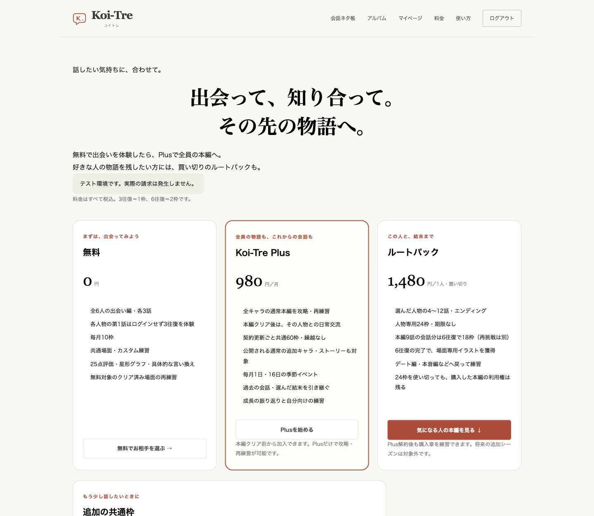
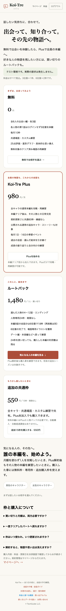
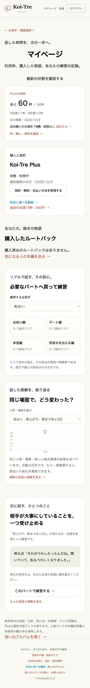

# 月額中心の料金・利用権・利用枠

決定日：2026-11-09。料金再設計の決定仕様。実装は`codex/plus-access-topup`で検証し、本番販売は「準備中」を維持する。

## 商品と遊べる範囲

価格はすべて税込。会話を新しく始めるには、対象コンテンツの利用権と必要な利用枠の両方が必要。

| 商品               | 料金・付与枠             | 利用権                                                                           |
| ------------------ | ------------------------ | -------------------------------------------------------------------------------- |
| 無料               | 0円・毎月10枠            | 全6人の1〜3話、共通・カスタム練習。各人物の第1話は未ログインで3往復体験可能      |
| Plus               | 月額980円・共通60枠      | 契約中は全員の通常本編の攻略・再練習。クリア後の日常交流と公開済みイベントも対象 |
| 人物別ルートパック | 1人1,480円・人物専用24枠 | 購入人物の4〜12話・結末。月額なしで攻略・再練習できる                            |
| 追加共通枠         | 550円・15枠              | 利用権は増やさず会話量を増やす。ログイン利用者なら非会員も購入可能               |

Plusは本編クリア前から加入でき、人物パックを併せて買う必要はない。公開する通常の追加キャラ・ストーリーも会員対象とする。今後の結婚後・喧嘩編等の制作・公開頻度、tips・プレゼントの新機能は今回の実装に含めない。

人物パックは、Plusをやめても好きな人物の本編へ戻りたい人や、最初から月額を使わず1人を攻略したい人向け。24枠は使い切りで、毎月の補充はない。使い切っても本編の利用権は残り、無料枠・追加購入枠で再練習できる。将来の追加シーズンは購入範囲に含めない。

追加15枠は全員で共有し、共通・カスタム練習にも使える。追加枠だけでは未購入の4話以降を解放せず、Plusまたは人物パックが必要。

## 枠の更新・消費

- 3往復＝1枠、6往復＝2枠。最初の返答の生成・保存成功時に一度だけ消費する。
- 途中再開・再送・生成失敗・評価の再試行・完了後の1回の言い直しで追加消費しない。
- 無料10枠は毎月1日・日本時間0時に更新。Plus60枠は支払い済みの契約期間で更新する。いずれも繰越なし。
- 会員中は無料10枠を別に加算しない。契約終了時に同じ月の無料枠を新しく重複発行しない。
- 人物専用24枠と追加購入15枠は期限なし。人物専用枠は対象人物の出会い・本編・再練習だけに使う。
- 消費順は「期限のある無料・Plus枠 → 対象人物の専用枠 → 追加購入の共通枠」。枠をまたいで必要な1／2枠を合算できる。
- 残枠不足は開始前に案内する。他の人物の専用枠を、その場面に使える枠へ含めない。自動購入・自動超過課金はしない。

## 攻略・再練習・解約

- 本編4〜12話の利用権は「Plus有効または対象人物パック購入済み」。会員権を購入済みの人物一覧へ書き換えない。
- Plusだけでもクリア済みステージを再練習でき、通常と同じ枠を使う。解約後の新規会話には、その人物のパック等が必要。
- 前話クリア、必要好感度、話ごとの合格点・配慮最低点は維持。課金で採点を甘くしない。追加の待ち時間や日次制限は設けない。
- 再練習はその話の時点の関係を使い、選んだ結末や本編進行を上書きしない。
- 日常交流・イベントは対象人物の本編クリアとPlus加入が必要。人物パック単独では対象外。イベント公開日も従来どおり検査する。
- 解約予約後も支払い済み期間末までは利用できる。終了後は未購入本編・日常交流・イベントで新しい会話を開始できない。
- 消費確定済みの途中会話は契約終了後も完了できる。最初の生成前に終了した場合は利用権を再確認する。
- 会話・分析・カード・XP・好感度・クリア記録、人物の購入権、未使用の人物専用・追加購入枠は保持する。

## 決済・データ

既存Checkout APIの`kind: 'topup'`で追加枠を購入する。金額550円・15枠・購入数量1はサーバーで固定し、クライアント指定値を採用しない。Stripeの顧客・購入ID・商品・JPY金額・支払い済み状態を照合して付与する。

既存の決済台帳・credit_grantsを使い、新規テーブル・migrationは不要。追加枠の付与IDはPaymentIntent単位とし、ユーザー行ロックと一意キーで通知・再照合・並行処理による二重付与を防ぐ。全額返金・紛争時は対応する枠を停止し、先に失効通知が来ても購入通知で復活させない。使用済み履歴は残す。

既存の購入・残枠・進行は書き換えない。有効な既存Plusには新しいアクセス範囲を適用する。

テスト用設定に`STRIPE_PRICE_TOPUP`を追加。`scripts/setup-stripe-test.mjs`は既存7商品と追加枠1商品の公開価格IDを準備する。本番では`BILLING_ENABLED=false`とProduction・本番キー拒否を継続し、変数をtrueにするだけで本番販売を始めない。

## 検証

- DB統合テストで非会員購入、固定価格・数量、通知・再照合の重複、返金の順序逆転、紛争・復元を確認する。
- Plusだけで攻略・再練習・クリア後の交流、残り0枠でも会員権が続くこと、追加枠だけでは本編を解放しないことを確認する。
- 開始APIへの直接POST、対象人物別の枠、1／2枠、消費順、更新・解約・期限境界、消費済み途中会話と記録保持を確認する。
- PC・スマホで料金・残枠・再練習・処理中・失敗・成功の導線を確認する。画面用会話・会員状態のfixtureとStripeの実サンドボックス購入を区別する。

調査時の仮説と事例は[料金・継続学習プラン比較資料](research/pricing-models-and-case-studies-2026-11-09.md)に残す。[初期の設計と検証履歴](routes-and-billing.md)の旧Plus条件より本書を優先する。

### 今回の検証記録

- 全312件の回帰テスト成功。型チェックはエラー・警告0件、Prettier・ESLint・Vercel向けビルド・出力検査が成功。
- 新規の専用ローカルPostgreSQLとFirebase Auth Emulatorの架空ユーザーを使用。Plusだけで第4話を開始し、6往復の最初の返答保存で60→58枠、追加購入用fixtureの15枠は保持されることを画面・APIで確認。パック未購入でも再練習ボタンを操作できる。
- 1440px・390pxで料金・残枠・全6人の再練習導線を確認。購入エラーはボタン付近へ表示され、処理中状態が解除される。
- 会員・購入枠の画面データとDify返答はローカルfixtureであり、実決済・実モデル評価の証拠には扱わない。Stripeサンドボックスでの実Checkout検証は、次節のとおり完了。

### Stripeサンドボックスの実決済検証（2026-11-09）

専用ローカルPostgreSQL・Firebase Auth Emulatorの新しい架空ユーザーを使用。決済とWebhookは実Stripeサンドボックスへ接続し、実課金・本番DB・本番設定は変更していない。会話・攻略済み履歴はfixtureで、実モデルの評価品質を検証した記録ではない。

| 確認                                      | 結果                                                                                                                                                                                     |
| ----------------------------------------- | ---------------------------------------------------------------------------------------------------------------------------------------------------------------------------------------- |
| 非会員の追加共通15枠・550円               | 拒否カードでは付与0。成功カードでは15枠を一度だけ付与し、期限なし。無料10枠と合わせて25枠                                                                                                |
| Webhookと購入状態の再照合                 | 実Webhookは200応答。成功後に3回再照合しても15枠のまま増えない                                                                                                                            |
| 本編未クリア・パック未購入のPlus980円加入 | 加入成功。共通60枠＋購入済み15枠の75枠で、無料10枠は重複しない                                                                                                                           |
| Plusだけで新規本編・再練習                | 第5話を6往復で開始して60→58、クリア済み第4話を3往復で再練習して58→57。購入15枠は保持                                                                                                     |
| Portalの期間末解約予約                    | 「次回更新を停止済み」を表示し、支払い済み期間の57枠と会員権を保持                                                                                                                       |
| 契約終了後の権利と途中会話                | サンドボックスAPIで即時終了させると、新規の未購入本編・有料再練習は403。消費済み第5話は6往復・70XPで完了し、無料10枠と購入15枠は追加消費されない。自然な契約期間の境界は自動テストで検証 |
| 追加枠の全額テスト返金                    | 550円の返金成功で対象15枠を失効。3回再照合しても復活せず、保存済み6往復・70XPは保持                                                                                                      |
| Plus終了後の人物パック1,480円             | 購入人物の利用権＋専用24枠（期限なし）を付与。Plus未加入でも購入した第4話の再練習を開始できる                                                                                            |

## 管理者のプレイ特例

管理者は購入・会員契約なしで全キャラクターの有料本編、日常交流、公開済みイベント、共通・カスタム練習を利用でき、3/6往復とも利用枠を消費しない。前話クリア・合格点・配慮・好感度・本編12話クリア・イベント公開日は通常どおり必要とする。既存の購入・契約・残枠は書き換えず、過去に消費した枠も返還しない。点数・分析・XP・カード・好感度・クリアは実際の会話に基づいて保存する。

管理者かどうかは各APIで検証済みFirebaseトークンから既存の管理権限判定を使って決め、リクエスト本文やDBの自己申告プロフィールでは免除しない。表示には購入権・会員権とは独立した `adminPlay` を返す。

会話開始と最初の生成予約では、進行条件を維持したまま購入・会員・残枠だけを免除する。初回の返答保存成功時に既存の `creditCost=0` と `chargedAt` で消費確定を記録し、購入枠の予約・消費台帳を増やさない。再開・再送・ゲスト体験の引き継ぎにも同じ判定を使う。初回保存前の再開・再試行で管理権限がなくなっていた場合は、通常の購入権・残枠を再検査する。保存成功済みの途中会話は権限変更後も追加消費なく完了できる。

検証は管理者の残枠0・3/6往復・本編4話以降・日常／公開済みイベント・カスタム・再練習・ゲスト引き継ぎ、進行と好感度による拒否、一般利用者の偽装拒否、初回保存前後の権限変更、失敗・再送・並行処理の無消費を対象とする。DB変更・決済の有効化は行わない。

### 管理者特例の確認記録

- 自動テスト341件が成功。管理者の0枠・3/6往復、有料本編、日常・公開済みイベント、再練習、共通・カスタム、ゲスト引き継ぎ、進行未達・採点不合格、権限変更、本文やプロフィールによる偽装を検証した。
- ローカル専用DB・認証エミュレーターの架空Google管理者で、購入0・契約なし・残枠0から第4話を6往復で完了し、カスタムも3往復で完了。保存済みコストは0、消費台帳は0行、残枠は0のまま。第5話への直接POSTは前話未クリアとして403。
- 管理者表示・全6人の再練習選択・合格点と好感度の表示をPC・スマホで確認した。架空の評価履歴と応答を使用しており、実モデルの採点品質の検証ではない。本番の利用者データや決済には触れない。
