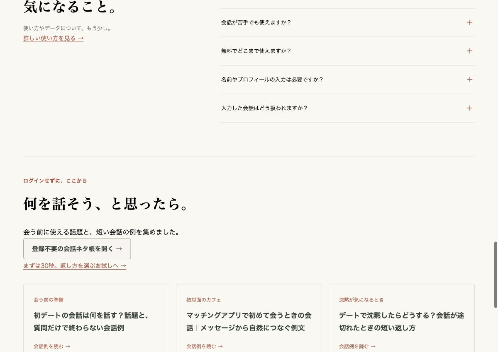

# 決済以外の旧Issueの確認（2026-11-03）

本番公開済みの変更が `main` に未統合だったため、現行コードを統合し、古いIssueを現在の仕様で確認する。決済・プラン別制限の #9・#14 は対象外。

| Issue                     | 現行の状態と根拠                                                                                                                                                                                                                                                                      |
| ------------------------- | ------------------------------------------------------------------------------------------------------------------------------------------------------------------------------------------------------------------------------------------------------------------------------------- |
| #2 スマホではみ出る       | 本番のLP・ログイン・ネタ帳・会話ガイド・お試し・紹介素材・問い合わせを320/390/768px幅で確認。各画面の文書幅は表示幅と一致。390pxのカスタム場面フォームで長文と呼び名を入力してもはみ出さない。PCのLPも1200px幅で確認。認証後の練習画面は初回公開時のスマホ検証記録を参照。            |
| #8 秘匿処理をサーバに移行 | Dify呼び出し・Firebaseトークン検証・DB保存は `$lib/server` と認証付きAPIで実行。Dify APIキーをクライアントへ渡さない。ビルド後のブラウザ用35ファイルで、手元に存在する秘密値の露出なしを確認。新フローはHTTPと保存状態の再取得で進行し、WebSocket中継を必要としない。                 |
| #10 LPの修正ポイント      | 日本語LP、会話と振り返りの見本、3場面、相手の呼び名・性別選択、カスタム場面、月10回の説明を公開済み。会話ネタ帳・ガイド・30秒お試しも公開済み。内容未定の旧タスクは完了扱いとし、追加改善は具体的な課題で起票する。                                                                   |
| #11 回数計測              | 質問単位の旧仕様を、最初の生成・保存成功で1回消費する月10練習の仕様へ置換済み。失敗時の予約解放、重複再送、別タブの競合、最終1枠、日本時間の月替わり、消費済み練習の再開を統合テストで確認。GA4のイベント数とDBの消費枠は別の値。                                                     |
| #12 Dify client error     | 添付画像は旧Dify埋め込み画面。現行本番のLPはiframeを使わず、アプリ内会話からサーバー経由で専用Workflowを呼ぶ。旧埋め込み自体の修理はせず、置換済みとして旧画面の課題を終了する。                                                                                                      |
| #7 CI・デプロイ           | 旧CIはNode.js 20と `@google-analytics/admin` のNode.js 22以上要件が衝突し、インストールで失敗。Node.js 24・固定pnpm・frozen lockfileへ変更し、lint・型・72テスト・ビルド・公開12ページのHTTP検証を実行する。Vercelの既存Git連携を利用し、main統合後にCIと本番デプロイを個別確認する。 |

ローカル確認はlint、型チェック（エラー・警告0）、72テスト、Vercel向けビルド（404画面のmanifest検証を含む）、公開12ページのSSRメタデータ・サイトマップ・非公開/404のnoindex検証を通過。

実Difyの3場面・各3返答、保存・消費、本番切替の既存の確認範囲は [初回練習の検証記録](practice-release.md) を参照。今回は本番ユーザーの質問や練習を追加していない。

## 画面の証跡

mainへ統合する現行画面（Production、2026-11-03）。今回の追加修正はCIと文書のみ。

スマートフォン幅390px：

PC幅1200px：

