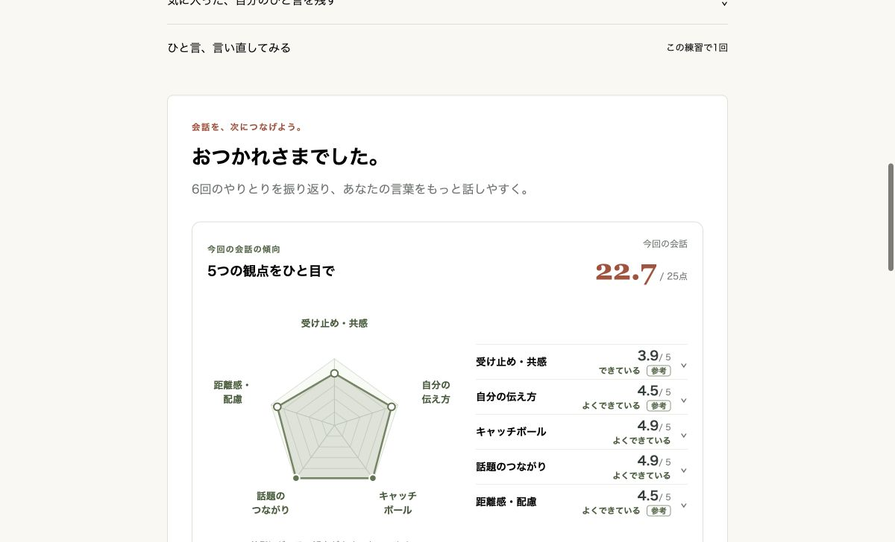
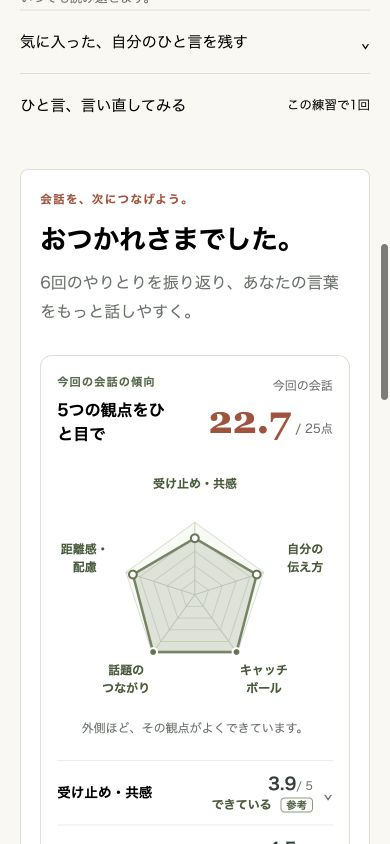
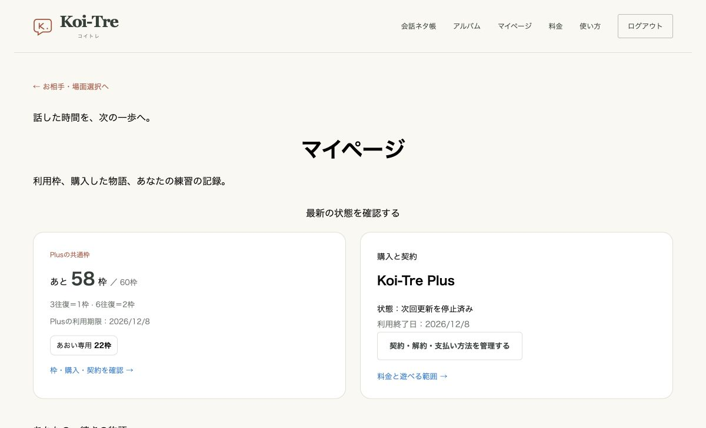

# 本編ルート・継続交流・採点・パート別再練習

> 2026-11-09整理：PR #21で本編・料金表示・テスト決済・再練習・専用イラストを本番公開済み。0004・0005の適用も完了。本番販売は停止を維持する。現行の公開状況は[仕様・実装状況](README.md)、判断軸は[評価・アドバイスの基本方針](evaluation-principles.md)を参照。下記には公開前の設計・当時の検証記録も残している。

## 承認範囲

無料は全6人の出会い編（1〜3話）と共通・カスタム練習、月10枠。人物別ルートパックは税込1,480円で4〜12話・結末と人物専用24枠を買い切り。Plusは税込月980円、契約期間ごと60共通枠（無料10枠と重複付与なし）。本編クリア済みの人物との日常・交際後の交流と、月2本の季節イベントを提供する。本編解放は人物別パックの購入で行い、Plusの加入は任意。

全プランで3往復1枠・6往復2枠。最初の返答の生成・保存成功時に一度だけ消費し、途中再開・再送・生成失敗・完了後の言い直しで追加消費しない。パック24枠は購入人物の出会い・本編・再挑戦に有効で期限なし。共通枠を優先し、足りない分をその人物のパック枠から使う。月額枠は契約日基準、無料枠は日本時間の月替わりで更新する。

各人物12話。出会い編1〜3、デート編4〜6、本音編7〜9、気持ちを伝える編10〜12。各話完了で次へ進む。購入・進行・利用枠はサーバーでも検査する。結末は「恋人として始まる」「もう少し時間をかける」の2種で、25点の採点とは別の物語上の判断。会話の根拠が確認できる結末を保存し、別の結末を再挑戦した場合は、本人が引き継ぐ結末を選ぶ。

追加要望：クリア済みの各パート・各話へ戻り、現実の機会に向けて練習できるようにする。再練習はその話の開始時点の関係・文脈を使い、本編の進行・選択済み結末・通常交流の記憶を上書きしない。元の会話と分析も保持する。

## データと責務

- 既存のpractices・practice_turnsを保持。practicesへ利用コスト・場面開始時の文脈・根拠付き結末を追加する。過去に消費済みの練習は従来の1枠として保持し、過去の利用枠や評価を再計算して課金しない。
- クレジット付与（無料月・有料契約期間・人物パック）と消費予約/確定を別テーブルで持つ。ユーザー行のロック内で利用可能枠を配分する。予約は生成リースと同じ期限で失効し、確定は練習単位で一度だけ。既存の消費履歴は無料枠の算出に引き続き含める。
- 購入セッション、Stripe顧客、人物の購入権、契約、処理済みイベントを保存する。クライアントの料金・枠数・uidは信用せず、サーバーカタログと認証ユーザーから決定する。
- 決済アダプターは公式Stripe SDK。Checkoutはサーバーで作成し、Webhookの署名・実決済・通貨・料金・商品・顧客・metadataを照合して権利を付与する。重複通知で24/60枠を重複付与しない。契約は最新のStripe状態を取得して同期し、遅延通知で古い有効状態へ巻き戻さない。
- 月額は支払い済みの契約期間を根拠に有効化する。解約予約はその期間末まで利用可能。支払い失敗は次の有料枠を付与せず、支払い済み期間の終了後に無料へ戻る。買い切り権と閲覧履歴は残す。全額返金・紛争時の対象購入権/残枠停止も処理する。
- キャラクターの会話文脈は本人の実際の会話と保存済みの根拠から作成する。再練習は開始時スナップショットを使う。日常交流は選択済みエンドの関係を引き継ぎ、本編の進行とは別に蓄積する。
- 月2イベントは公開日付きの季節テーマから解決する。未公開の月・後半イベントを直接ID指定しても開始できない。公開済みはアーカイブに残す。イベントと日常交流はPlusと本編クリアをサーバーで検査する。

## 採点

Jevの基準を各観点0〜5の6段階へ更新し、受け止め・共感、自分の伝え方、キャッチボール、話題のつながり、距離感・配慮の合計25点を表示する。キャッチボールには質問だけでなく回答・感想・自己開示・自然な終了を含める。実評価の出力だけを使い、AI生成文から数値を捏造しない。旧0〜3の評価は旧基準と分かる形で保持する。評価障害や材料不足は0点で補完しない。

6往復は全6返答と会話全体を分析する。3往復の完了20XP＋ミッション10XP、6往復は完了50XP＋ミッション20XP。保存済みの旧報酬は書き換えない。

## 実装・検証・公開

1. カタログ72話・パート・日常・季節イベント、純粋な権利/採点/コスト規則を作成。
2. schemaを更新し、generateしたDDLをレビュー。独立した検証DBで適用し、2回目のgenerateが差分なしになることを確認。
3. 消費予約、購入・契約の同期、進行・結末・再練習の保存を実装。APIは既存のFirebase認証と本人アクセス制限を維持。
4. 料金・購入状態・各パートの進行/再練習・残枠・25点評価・契約管理画面を実装。操作中・成功・失敗を操作箇所へ表示。
5. DB統合テストで重複/順序逆転/権限/並行消費/更新境界/途中再開/購入権/再練習の不変条件を確認。Stripeテスト決済とPC・モバイルの画面を実操作する。
6. Difyの文脈・記憶・結末・6返答分析を実モデルで検証し、保存パーサーで引用を照合。型・整形・lint・全テスト・ビルド・公開SEOを確認。
7. 本番は対象プロジェクト/コミット/DBを照合し、加算的migration→Dify更新→CI成功済みコードの順に反映。決済の本番設定は別途確認し、未設定時は購入を準備中として表示する。テストキーで本番販売を有効化しない。既存の途中練習と閲覧は保持する。

## 外部仕様

- Stripe: https://docs.stripe.com/webhooks / https://docs.stripe.com/billing/subscriptions/webhooks
- Jev Score: https://docs.typesafe.ai/primitives/score

## Stripeテスト環境の設定

`.env.example` の課金項目を使う。`BILLING_ENABLED=true` と `sk_test_` の秘密鍵が必要。本番キーでは起動せず、Vercel Productionでも決済APIは有効化しない。

```bash
node --env-file=.env scripts/setup-stripe-test.mjs
stripe listen --forward-to http://localhost:5173/api/webhooks/stripe
```

セットアップスクリプトは固定のlookup keyで7商品・価格と、期間末解約用の専用Portal設定を再利用する。表示された公開IDを対応する `STRIPE_PRICE_*` と `STRIPE_PORTAL_CONFIGURATION_ID` に設定し、Stripe CLIが表示する署名シークレットを `STRIPE_WEBHOOK_SECRET` に設定する。秘密鍵・署名シークレットはGitやチャットへ載せない。CheckoutとPortalの戻り先には `VITE_APP_DOMAIN` のoriginだけを使用する。

Previewで検証するときも、テスト用DB・Firebase・Difyを分離し、そのPreviewの `/api/webhooks/stripe` へStripeテスト通知を送る。本番DBや本番ユーザーにテスト購入権を付けない。

## 実施した検証（2026-11-08）

以下は料金・進行実装時の記録。6往復のカードを場面専用イラストへ変更した追加実装・175件の検証結果・その追加時のキャプチャは [専用イラストの仕様と検証](special-card-art.md) に記載する。

Checkoutの再試行と返金通知の順序逆転に対する修正、追加migration `0005`、186件の検証結果は [決済レビュー対応](billing-review-fixes.md) に記載する。`0004` と `0005` はPR #21の本番公開時に適用済み。

- 171件の統合テスト成功。既存134件に加え、1/2枠の消費・予約・古いリースの解放・購入済み人物の制限・再送・重複通知・支払い失敗・更新・返金・期間末解約・再練習の文脈と結末保持・本人認証・Webhook署名を確認。
- 型チェックはエラー・警告とも0件、Prettier/ESLint・本番向けビルド・Vercel出力検査が成功。13公開ページのSSRメタデータ・サイトマップと、非公開/404のnoindexをHTTPで確認。
- 独立したPostgreSQLへ全migrationを適用し、2回目のgenerateで差分なし。0004は8テーブルと既存practicesの3列を追加するDDLのみ。
- Stripeサンドボックスで実Checkoutを操作。拒否カードでは購入権/24枠とも0件。成功カードではあおいの本編と24枠が各1回付与された。
- Firebase Auth Emulatorの架空ユーザーで、画面からあおいの1〜12話を順に完了。Plus購入後に共通60枠を付与し、本音編へ戻る6往復で58枠になった。専用枠は22枠を保持。再読み込みでも追加消費なし。
- 専用PortalでPlusを解約予約。実際のStripeが `cancel_at` に期間末を返すケースも同期し、「次回更新を停止済み」と残枠を表示。
- Difyのgpt-6-luna/lowとJev実モデルjev-1.14.0で、6返答の本音編・交際を望む結末・保留する結末を確認。全返答の引用を保存パーサーで照合。初回は質問を足さず、相手の希望に応答した。
- DifyにStrict JSON Schemaを設定し、6返答分析と結末の構造を固定。定義は `dify/practice-output.schema.json` とDSLのcompletion_paramsへ保存。引用は引き続きアプリでも原文照合する。
- 390pxとPC幅で星形グラフを確認。スマホの横はみ出しなし。画像は架空会話のローカル検証画面。12話進行の生成は表示・保存用fixture、掲載した6往復分析は同じ架空会話に対するDify実出力、数値はアプリから取得したJev実評価を使用した。







## 公開前の判断と手順（2026-11-08時点の記録）

以下はPR #21公開前の記録。後に本番アプリ・DB・新版Difyを公開し、販売停止は維持した。

この実装段階の指定は「まずテスト決済まで」。本番販売・Stripe本番キーの設定は実施しない。コードはレビュー用PR、Difyは未公開の改訂ドラフトまでとし、本番DB・本番アプリ・公開済みDify #7は変更しない。

リリース時は、追加migrationとアプリの対応版、Difyの改訂版をまとめて反映する。旧アプリはanalysis.version=3を受け取れないため、Difyドラフトだけを先に公開しない。DifyのDSL・Schemaをテスト用アプリへ取り込み、Previewではそのテスト用APIキーで通してから公開する。販売を始める場合は、本番Stripeアカウントと販売開始の承認を得たうえで、Productionと本番キーを拒否する現在のガードを別変更で見直す。
