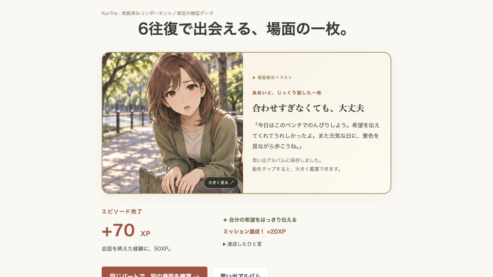
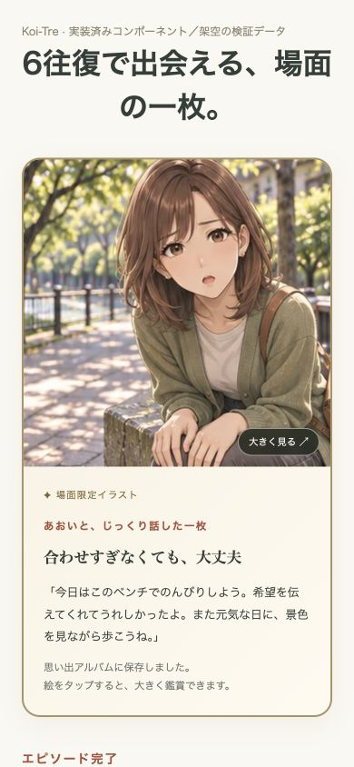
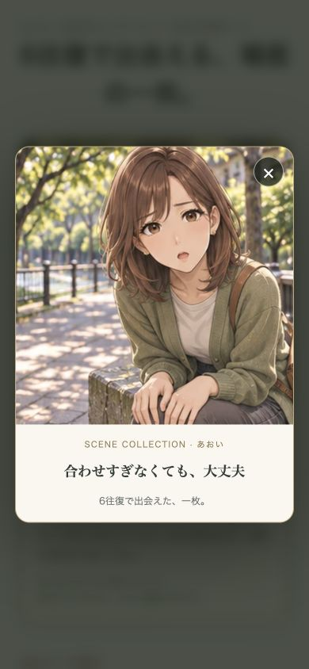
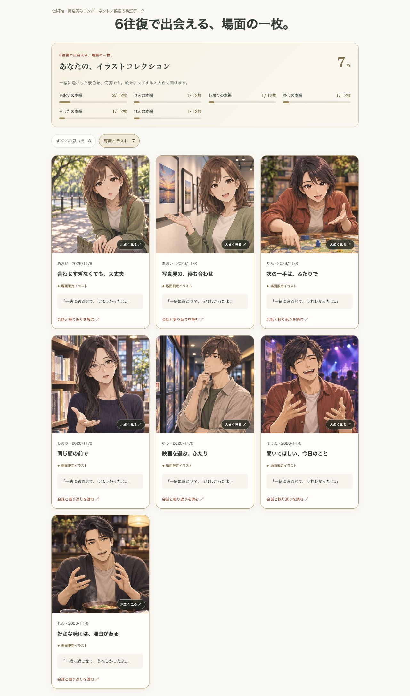

# 6往復の場面専用イラスト

> 2026-11-09整理：専用イラストはPR #21で本番公開済み。下記の「本番を変更しない」等は追加実装・検証を行った2026-11-08時点の記録。[現在の公開状況](README.md)を参照。本番課金は引き続き停止中。

## 目的と表示

金枠と立ち絵だけだった6往復のカードを、相手の顔・服装を保った背景付きの専用イラストに変更する。通常3往復は従来の立ち絵カードを残す。6往復の完了カードとアルバムでは場面の一枚を主役にし、拡大表示できるようにする。

本人の性別や容姿を固定しない一人称の構図にする。交際の成立・キス等を必須にせず、断りや保留にも合う、その場の時間を描く。会話にない結果を画像で断定しない。

## 対象とデータ

- 全6人×本編12話＝72場面に個別の絵を用意する。
- 共通6場面・日常4場面も人物ごとの絵を用意する。
- 月2本×12か月の季節イベントも、その人物と季節に合う絵を用意する。
- 配布する画像は人物・用途別のアトラスとし、各セルに別の場面を描く。単なる立ち絵の背景差し替えにしない。セル順序はカタログとの対応表で固定する。
- 獲得済みの判定は既存の6往復完了履歴を使う。DB、利用枠、採点、XP、本編進行、選択した結末の規則は変更しない。既存の6往復カードにも専用イラストを表示する。
- 未獲得のカードに専用絵を表示しない。会話開始前は「6往復で場面専用イラストを獲得」と案内する。

## 実装・検証

1. 既存画像を参照して専用絵を作成し、人物・場面・セルの位置・文字混入・不自然な手を確認する。制作プロンプトと対応表を残す。
2. 場面IDから画像とセルを返す純粋なカタログ、表示部品、獲得済みカードだけの拡大ビューを作成する。
3. 完了画面・アルバムを更新し、6往復の獲得数と保存済み会話への導線を保つ。
4. 全カタログの画像対応・存在・3往復との分離を検証する。型・lint・既存統合テスト・ビルドを確認し、PCとスマホで完了カード・アルバム・拡大と閉じる操作を実際に確認する。
5. 既存のテスト決済PRへ追加する。本番課金・本番アプリ・Dify公開版は変更しない。

## 制作物と実装結果（2026-11-08）

全276場面の絵を組み込みの `image_gen` で制作し、24枚のWebPを `static/images/special-cards/` に保存した。人物ごとの既存ポーズ画像を参照し、背景・視点・腕や手の動きも場面に合わせて描いている。各アトラスを目視し、人物・配列・場面を確認した。[制作プロンプトと場面IDの対応表](special-card-art-prompts.json)、[配列と保存先](../static/images/special-cards/README.md) を残す。

6往復の完了画面とアルバムに専用絵を表示する。アルバムでは専用イラストの絞り込み、獲得枚数、人物別の本編12枚の収集状況を表示する。本編の収集数は同じ場面の再挑戦を重複計上しない。拡大画面は閉じるボタン・Escapeに対応し、閉じた後は元のカードへフォーカスを戻す。読み込み中・失敗を画像の場所へ表示し、拡大画面から再読み込みできる。

獲得条件は保存済みの6往復完了。点数やミッションの成功は問わない。3往復は従来の立ち絵カードを維持する。既存6往復カードにも絵を付け、課金・消費枠・進行・結末・DBの規則は変更していない。毎回の画像生成は行わない。

## 検証

- 全175件のテスト成功。追加の4件で、276場面の重複しないセルと実WebP24枚、人物・場面の境界、完了済み6往復のみの表示、重複しない本編収集数を確認した。既存の枠消費・決済・再練習・結末保持の回帰テストも成功。
- 型チェックはエラー・警告とも0件。Prettier/ESLint、ビルド、Vercel出力検査が成功。今回のビルドを配信するローカル5185番で、13公開ページのSSR/SEO、非公開/404のnoindex、24枚のWebPのHTTP配信を確認した。
- ローカルで実装済みの `AdventureResult`・`MemoryGallery`・`StoryPicker` へ架空のデータを渡し、PC 1280×720とスマホ390×844で確認。専用絵と通常絵の分離、7枚の専用絵への絞り込み、6人の画像読み込み、拡大、閉じるボタン、Escape、フォーカス復帰、6/3往復切り替え時の報酬案内を確認した。横はみ出し・ブラウザのconsole errorは0件。
- この追加UI検証はコンポーネント単位。認証・保存・Stripeテスト決済の通し検証は [料金・進行の検証記録](routes-and-billing.md) に記載した前のリビジョンで行ったもの。今回のキャプチャを実課金や本番保存の証跡として扱わない。
- 本番アプリ・本番DB・Stripe本番設定・Dify公開済み #7 は未変更。既存のテスト決済用PRに追加し、本番反映は行わない。

PCの完了カード（実装コンポーネント、架空データ）:

スマホの完了カードと拡大表示（390px）:

PCのアルバム（専用イラストで絞り込み）:

